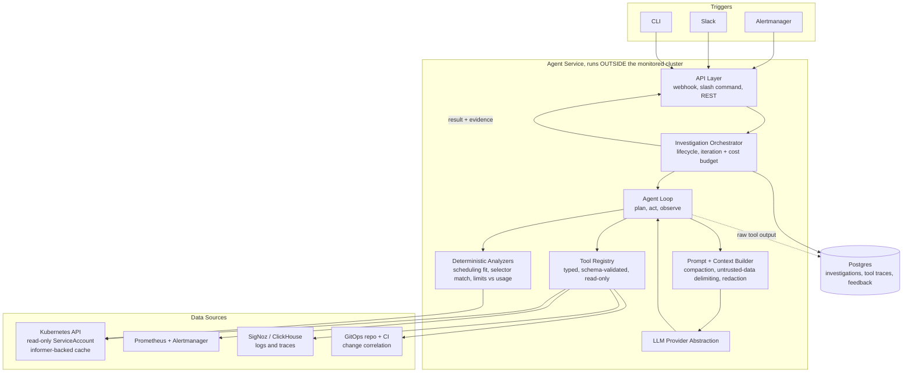

# k8s-triage-agent

An AI agent that investigates Kubernetes incidents. It receives an alert or a
question, gathers cluster evidence on its own, and returns ranked hypotheses
with the exact evidence behind each one.

Read-only by default. It cannot change your cluster.

> **Status: early development.** The design is settled and documented in
> [docs/PRD.md](docs/PRD.md). The scenario benchmark comes first, the agent
> follows. See [Roadmap](#roadmap) for what actually works today.

---

## Why

The first 15 minutes of a Kubernetes incident are mechanical: pull pod status,
read events, find the right container's logs, check node pressure, compare
against the last rollout, correlate with Prometheus. It is the same work every
time, it is already written down in runbooks, and it is what stands between an
on-call engineer and their first real hypothesis.

This agent does that part.

## What it does

Given `KubePodCrashLooping` firing on `checkout-api`, it works through the
cluster on its own and comes back with something like:

```
Hypothesis 1 (high confidence)
  Container is OOM-killed because the memory limit sits below steady-state usage.

  Evidence:
    describe_resource   lastState.terminated.reason=OOMKilled, exitCode 137
    query_prometheus    container_memory_working_set_bytes p95 = 480Mi, limit 512Mi
    get_rollout_history no image change in 14 days, so this is not a regression

  Suggested action: raise memory limit to 768Mi  (risk: low, needs approval)

Ruled out
  Node memory pressure       all nodes report MemoryPressure=False
  Failing liveness probe     no Unhealthy events in the window

Unknowns
  No trace data available for this service
```

Three rules the output always follows:

1. **Every hypothesis cites real evidence.** Citations point at tool calls that
   actually happened, and the raw output is stored so you can check.
2. **It says what it does not know.** `unknowns` is never omitted.
3. **It reports what it ruled out.** That saves you from repeating the checks.

## Architecture



Four decisions worth calling out:

**No shell, no kubectl passthrough.** The agent's only access to the world is a
set of typed, schema-validated tools. The blast radius is reviewable in a pull
request. See [ADR 0001](docs/adr/0001-typed-tools-over-shell.md).

**Deterministic checks stay in Go.** Scheduling fit, selector matching, and
limits-versus-usage arithmetic are code. The model orchestrates and explains, it
does not do math that a computer can do correctly.

**Tool output is compacted before it reaches the model.** Raw output goes to
storage, a summary goes to the context. A large cluster otherwise exhausts the
window in three tool calls.

**It runs outside the cluster it watches.** An agent sharing a failure domain
with its subject is offline during exactly the incidents it exists for. See
[ADR 0002](docs/adr/0002-run-outside-the-monitored-cluster.md).

## Safety model

| Control | Implementation |
|---------|----------------|
| Read-only access | ClusterRole with `get`, `list`, `watch` only. No mutating verbs exist in the binding |
| No secret exposure | `secrets` is not in the ClusterRole at all. The API has no metadata-only read, so the agent infers Secret problems from Pod status and Events |
| No exec | `pods/exec` and `pods/portforward` excluded. Not needed for diagnosis, and an exfiltration path |
| Redaction | All tool output passes a scrubber before entering the model context |
| Prompt injection | Cluster-sourced text (annotations, log lines, image names) is delimited as untrusted data. Anyone who can write a log line can try to steer the agent |
| Budgets | Hard per-investigation ceilings on tool calls, wall clock, and cost. Stops, not warnings |
| Audit | Every tool call and model call logged with inputs, outputs, and requesting identity |

Remediation is Phase 2, uses a separate ServiceAccount, and requires explicit
human approval plus a dry-run diff for every action. See
[deploy/kubernetes/rbac.yaml](deploy/kubernetes/rbac.yaml) for the annotated
permission set.

## Quick start

Requires Go 1.24+, a kubeconfig, and an Anthropic API key.

```bash
git clone https://github.com/davidsugianto/k8s-triage-agent
cd k8s-triage-agent

cp configs/config.example.yaml configs/config.yaml
export ANTHROPIC_API_KEY=sk-...

make build
./bin/agent-cli investigate --namespace prod --workload checkout-api
```

Run the benchmark against a throwaway cluster:

```bash
make kind-up
make eval
make kind-down
```

## Project layout

```
.
├── cmd/
│   ├── agent-server/          # API, Alertmanager webhook, Slack surface
│   └── agent-cli/             # local investigation from kubeconfig context
├── internal/
│   ├── handler/               # HTTP, Slack, webhook delivery
│   ├── usecase/
│   │   ├── investigation/     # orchestration, budgets, result assembly
│   │   └── remediation/       # Phase 2: approval flow, dry-run, execute
│   ├── agent/
│   │   ├── loop/              # plan, act, observe
│   │   ├── llm/               # provider abstraction
│   │   ├── prompt/            # system prompt, context assembly
│   │   └── tools/             # tool registry and schemas
│   ├── repository/
│   │   ├── kubernetes/        # informer-backed read-only client
│   │   ├── prometheus/
│   │   ├── logs/
│   │   └── postgres/          # investigation persistence
│   ├── domain/                # Investigation, Hypothesis, Evidence
│   └── config/
├── pkg/redact/                # secret and credential scrubbing
├── deploy/kubernetes/         # RBAC and management-cluster manifests
├── configs/                   # example configuration
├── test/
│   ├── scenarios/             # reproducible broken clusters, known root causes
│   └── harness/               # runs scenarios, scores results
└── docs/
    ├── PRD.md                 # full product requirements
    └── adr/                   # architecture decision records
```

## How correctness is measured

The benchmark exists before the agent, and it is the CI gate on every prompt or
tool change.

Each scenario in `test/scenarios/` is a reproducible broken cluster with a known
root cause. Scoring checks three things:

- Does the top-ranked hypothesis match the real root cause?
- Did the cited tool calls actually happen and return what the hypothesis
  claims? A right answer built on fabricated evidence scores as a failure.
- How many tool calls and how much money did it take?

Ten scenarios are held out and never used during prompt iteration. At least two
have "insufficient evidence" as the correct answer, because an agent that always
produces a confident hypothesis is guessing rather than diagnosing.

**The metric that matters most is false confidence rate**, not raw accuracy. An
agent that says "I do not know" is useful. An agent that confidently sends you
after a NetworkPolicy when it is actually an OOM kill is worse than no agent at
3am.

| Metric | Target |
|--------|--------|
| Top-1 accuracy on benchmark | 80% |
| False confidence rate | under 5% |
| Time to first hypothesis | 60s p95 |
| Cost per investigation | $0.25 p95 |

## Roadmap

- [ ] **M0** Benchmark: 15 reproducible scenarios on kind, automated scoring
- [ ] **M1** Tool layer: read-only client, 8 core tools, `envtest` coverage
- [ ] **M2** Agent loop: planning, dispatch, budget enforcement, structured output
- [ ] **M3** CLI surface, full benchmark run, prompt iteration to 70% top-1
- [ ] **M4** Prometheus and log tools, 40 scenarios, target 80%
- [ ] **M5** Slack bot, Alertmanager webhook, Postgres persistence
- [ ] **M6** Shadow mode against production alerts, feedback capture
- [ ] **M7** Phase 2 remediation with approval flow and a narrow allowlist

## Prior art

[k8sgpt](https://github.com/k8sgpt-ai/k8sgpt) and
[HolmesGPT](https://github.com/robusta-dev/holmesgpt) occupy the same space and
are worth running against your own clusters before adopting anything here. This
project exists because deep integration with a specific stack is where most of
the diagnostic accuracy comes from, and because the safety model needed for a
production cluster is stricter than a general-purpose tool tends to ship with.

## License

MIT. See [LICENSE](LICENSE).
