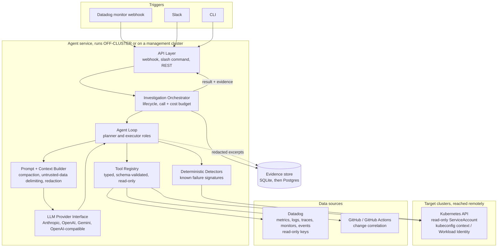

# upsera-agent

Open source AI agents for platform and SRE work, built in Go. The first agent
is **k8s-triage-agent**: it takes a Datadog monitor alert for a Kubernetes
workload, gathers evidence on its own, and returns ranked hypotheses with the
exact evidence behind each one.

Read-only by default. It cannot change your cluster, and it never writes to
Datadog.

> **Status: early development, Phase 1 (diagnose CLI) nearly complete.** The
> product design is in the [PRD](docs/k8s-triage-agent-prd.html). What exists
> today: the Phase 0 foundations (config loading, telemetry, health endpoints,
> reader RBAC, Helm chart, dev environment, CI, ADRs), plus `agent-cli diagnose`
> (read-only, eight detectors, SQLite evidence store, optional `--summarize` LLM
> summary that rejects uncited claims) and the scenario eval harness
> (`make eval`, `make eval-llm`). `agent-cli mcp` serves the six read-only
> Kubernetes tools to an MCP client over stdio. The LLM eval run is still
> pending. There is no Datadog client, alert receiver, Postgres, or Slack yet
> (Phase 2). The example output under "What it will do" is the target, not
> current behaviour. See [Roadmap](#roadmap).

---

## Why

The first 15 minutes of a Kubernetes incident are mechanical: pull pod status,
read events, find the right container's logs, check node pressure, compare
against the last rollout, correlate with Datadog metrics, logs, and traces. It
is the same work every time, it is already written down in runbooks, and it is
what stands between an on-call engineer and their first real hypothesis.

k8s-triage-agent does that part.

## What it will do

Given a Datadog monitor firing on `checkout-api`, it works through the cluster
and Datadog on its own and comes back with something like this. This is the
target output, not something that runs today:

```
Hypothesis 1 (high confidence)
  Container is OOM-killed because the memory limit sits below steady-state usage.

  Evidence:
    k8s_describe        lastState.terminated.reason=OOMKilled, exitCode 137
    dd_metrics          kubernetes.memory.working_set p95 = 480Mi, limit 512Mi
    rollout_history     no image change in 14 days, so this is not a regression

  Suggested action: raise memory limit to 768Mi  (risk: low, needs approval)

Ruled out
  Node memory pressure       all nodes report MemoryPressure=False
  Failing liveness probe     no Unhealthy events in the window

Unknowns
  No trace data available for this service
```

Three rules the output always follows:

1. **Every hypothesis cites real evidence.** Citations point at tool calls that
   actually happened, and a redacted excerpt is stored so you can check.
2. **It says what it does not know.** `unknowns` is never omitted.
3. **It reports what it ruled out.** That saves you from repeating the checks.

## Architecture

Datadog is the only source of alerts and telemetry. Live cluster state comes
from the Kubernetes API of each target cluster. The agent runs outside the
clusters it diagnoses and reaches them remotely.



Decisions worth calling out:

**No shell, no kubectl passthrough.** The agent's only access to the world is a
set of typed, schema-validated tools. The blast radius is reviewable in a pull
request. See [ADR 0001](docs/adr/0001-typed-tools-over-shell.md).

**It runs outside the cluster it watches.** An agent sharing a failure domain
with its subject is offline during exactly the incidents it exists for. See
[ADR 0002](docs/adr/0002-run-outside-the-monitored-cluster.md).

**The LLM is configuration.** Provider, planner model, and executor model are
set in config, behind a thin Go interface: Anthropic, OpenAI, Gemini, or any
OpenAI-compatible endpoint such as Ollama or vLLM. A provider needs tool calling
and structured output, and counts as supported only if it passes the eval
suite. Today the Anthropic and OpenAI-compatible adapters exist. See
[ADR 0003](docs/adr/0003-llm-provider-interface.md).

**Deterministic checks stay in Go.** Known signatures such as OOMKilled or
ImagePullBackOff are detected by code. The model correlates and explains, it
does not do work a computer can do correctly.

**Tool output is compacted and redacted before it reaches the model.** Only
redacted excerpts are stored, and raw logs stay in Datadog.

**Datadog is read-only.** The agent reads monitors, metrics, logs, traces, and
events through a `DatadogClient` interface and never creates, edits, mutes, or
resolves anything. See [ADR 0006](docs/adr/0006-datadog-client-api-vs-mcp.md).

Storage and the home of remediation records are tracked in
[ADR 0004](docs/adr/0004-storage.md) and
[ADR 0005](docs/adr/0005-remediation-requests-crd-vs-db.md). ADR 0004 is
accepted. ADR 0005 is proposed and deferred to Phase 4.

## Safety model

| Control | Implementation |
|---------|----------------|
| Read-only access | Reader ClusterRole with `get`, `list`, `watch` only. No write verbs in the binding |
| No secret exposure | `secrets` is not in the ClusterRole at all. The agent infers Secret problems from Pod status and Events |
| No exec | `pods/exec` and `pods/portforward` excluded. Not needed for diagnosis, and an exfiltration path |
| Datadog is read-only | Read-only API and application keys with the narrowest scopes, taken from the environment. The agent never writes to Datadog |
| Redaction | Tool output, including Datadog log, span, and monitor-message excerpts, passes a scrubber before entering the model context |
| Prompt injection | Cluster- and Datadog-sourced text (annotations, log lines, monitor messages) is delimited as untrusted data |
| Budgets | Hard per-investigation ceilings on tool calls, wall clock, and cost. Stops, not warnings |
| Audit | Every tool call and model call recorded with inputs, outputs, and requesting identity |

Of these, what exists today is the reader RBAC (see
[deploy/helm/k8s-triage-agent](deploy/helm/k8s-triage-agent)), a redaction
scrubber (`pkg/redact`) applied to stored evidence excerpts and provider error
messages, and caps on tool calls (`agent.max_tool_calls`) and on LLM calls and
tokens (`internal/agent/llm/budget.go`). Wall-clock and cost ceilings are not
built. Audit is partial: each tool call is stored as an evidence row with its
redacted excerpt, but model calls are not recorded.

Remediation is Phase 4, uses a separate ServiceAccount, and requires explicit
human approval plus a dry-run diff for every action.

## Development

Requires Go 1.26+, `make`, Docker, `kind`, `kubectl`, `helm`, and OpenTofu
(`tofu`).

```bash
make ci            # build, vet, test, lint, helm-lint, tofu-validate
```

To run the agent locally against a throwaway cluster:

```bash
export DD_API_KEY=...             # read-only Datadog API key
export DD_APP_KEY=...             # read-only Datadog application key
export DD_SITE=datadoghq.com      # your Datadog site
export ANTHROPIC_API_KEY=...      # or the key for the provider set in config

make dev-up                       # create kind cluster upsera-lab (context kind-upsera-lab), apply reader RBAC
make dev-collector                # start the OpenTelemetry Collector (Datadog exporter)
make dev-run                      # run agent-server as the read-only ServiceAccount against it
make check-datadog                # verify the Datadog credentials
make verify-telemetry             # no Datadog needed: agent telemetry reaches a local collector
make dev-down                     # delete the kind cluster
```

`make help` lists every target. The LLM key is only needed for
`agent-cli diagnose --summarize` and `make eval-llm`.

Configuration is a YAML file (copy `configs/config.example.yaml` to
`configs/config.yaml`). Secrets are referenced by environment variable name in
the file and are never stored in it.

**Dev only ever touches the kind cluster `kind-upsera-lab`.** The dev targets
pass `--context kind-upsera-lab` explicitly and refuse to run against any other
context. Do not point them at a real cluster, and do not switch your current
kubectl context to run them.

Infrastructure for the GKE lab is OpenTofu in `infra/gke-lab`. CI runs
`tofu fmt`, `init -backend=false`, and `validate` only. Nothing in this repo
runs `tofu plan` or `tofu apply` for you.

## Try it

`agent-cli diagnose` inspects one workload with read-only Kubernetes calls and
reports known failure signatures (no LLM involved unless you add
`--summarize`). It needs a config file with the cluster listed (see above) and
a kubeconfig context for it:

```bash
go run ./cmd/agent-cli diagnose deploy/memory-hog -n demo --cluster kind-upsera-lab
go run ./cmd/agent-cli diagnose sts/db -n demo --json     # machine-readable
```

The target is `<kind>/<name>` with `deploy`, `sts`, or `ds`. `--cluster` can be
omitted when the config has exactly one cluster. Namespaces denied by the
config are refused before any API call. Redacted evidence excerpts are written
to `$XDG_STATE_HOME/upsera-agent/evidence.db` (or `~/.local/state/...`); change
it with `--evidence-db`. Findings cite evidence ids such as `E3`. Exit codes: 0
finished, 1 runtime error, 2 usage error. `agent-cli diagnose --help` lists all
flags.

Add `--summarize` to get ranked hypotheses on top of the findings. After the
read-only checks, one model call turns the stored evidence into at most three
hypotheses, each with a confidence, the evidence ids it rests on (`E3, E5`), and
what would disprove it, plus what the evidence rules out. Claims that do not cite
stored evidence are dropped and counted as `rejected claims`. It is off by
default, so nothing needs an API key unless you ask for it. The key is read from
the environment variable named by `llm.api_key_env` in the config
(`ANTHROPIC_API_KEY` in the example). For the `anthropic` provider, an empty key
falls back to `ANTHROPIC_AUTH_TOKEN` or a profile from `ant auth login`. Either
way the calls bill the API organization (neither route is free), and with no
credential the command stops with exit 1 before the cluster is touched. The call uses `llm.planner_model` and is
capped at `agent.max_llm_tokens` tokens; `agent.max_tool_calls` (default 25) caps
the cluster reads, inspecting the least healthy pods first.

```bash
export ANTHROPIC_API_KEY=...
go run ./cmd/agent-cli diagnose deploy/memory-hog -n demo --summarize
```

A `degraded: <reason>` line means the model output could not be used (a refusal,
an exhausted budget, a provider error, or output that failed validation). The
deterministic findings above it are still complete and the exit code stays 0.
With `--json`, `hypotheses`, `ruled_out`, `llm` (model, tokens), `rejected_claims`
and `degraded` are included.

### MCP server

`agent-cli mcp` serves the six read-only Kubernetes tools to an MCP client over
stdio:

```bash
go build -o bin/agent-cli ./cmd/agent-cli
bin/agent-cli mcp --config /abs/path/to/config.yaml [--cluster NAME] [--kubeconfig PATH]

# register it with Claude Code (use the absolute binary path, or put agent-cli on PATH)
claude mcp add upsera-triage -- /abs/path/to/bin/agent-cli mcp --config /abs/path/to/config.yaml
```

`--config` is required and must be an absolute path. MCP clients start the
server in the open project's directory, so a relative or default path would let
an opened repo choose the cluster. At startup the server logs the config path,
cluster and kubeconfig context to stderr.

Tool output is redacted and size-capped but not wrapped in untrusted-data
framing, so the client must treat it as untrusted data. Stdout is the protocol
channel; logs go to stderr.

## Evals

```bash
make dev-up        # kind cluster the scenarios run on
make eval          # deterministic scenarios, writes test/results/report.json
make eval-llm      # scores the --summarize step vs the baseline; SPENDS REAL API MONEY
```

`make eval-llm` needs the key named by `llm.api_key_env` and a baseline from
`make eval`. See [test/scenarios/README.md](test/scenarios/README.md).

## Project layout

```
.
├── cmd/
│   ├── agent-server/          # service: health endpoints now; webhook and Slack later
│   └── agent-cli/             # local investigation from a kubeconfig context
├── internal/
│   ├── config/                # YAML config loading
│   ├── handler/               # HTTP, Slack, webhook delivery
│   ├── usecase/
│   │   ├── investigation/     # orchestration, budgets, result assembly
│   │   └── remediation/       # Phase 4: approval flow, dry-run, execute
│   ├── agent/
│   │   ├── loop/              # planner and executor loop
│   │   ├── llm/               # provider interface and adapters
│   │   ├── prompt/            # system prompt, context assembly
│   │   └── tools/             # tool registry and schemas
│   ├── repository/
│   │   ├── kubernetes/        # read-only client
│   │   ├── datadog/           # DatadogClient: API and MCP backends, record/replay
│   │   └── postgres/          # persistence from Phase 2
│   └── domain/                # Investigation, Hypothesis, Evidence
├── pkg/redact/                # secret and credential scrubbing
├── deploy/helm/               # Helm chart for k8s-triage-agent
├── infra/gke-lab/             # OpenTofu for the GKE lab
├── configs/                   # example configuration
├── test/
│   ├── scenarios/             # reproducible broken clusters, known root causes
│   └── harness/               # runs scenarios, scores results
└── docs/
    ├── k8s-triage-agent-prd.html   # product requirements
    ├── adr/                        # architecture decision records
    └── archive/                    # superseded documents
```

Some packages above are still placeholders (for example `remediation`, `loop`,
`datadog`, `postgres`). The directories exist so the layout is
settled, not because the code does.

## How correctness will be measured

The eval suite starts in Phase 1 and gates every later release.

Each scenario in `test/scenarios/` is a reproducible broken workload with a
known root cause. Kubernetes-only scenarios run on kind. Scenarios that need
Datadog data use recorded Datadog responses in pull request CI and the live lab
nightly. Because model output varies, each scenario runs three times and passes
when at least two runs name the expected cause with valid evidence.

Scoring checks:

- Does the top-ranked hypothesis match the real root cause?
- Did the cited tool calls actually happen and return what the hypothesis
  claims? A right answer built on fabricated evidence scores as a failure.
- How many tool calls and how much money did it take, per provider and model?

At least one scenario is a prompt injection through a log line, and the correct
result is a right diagnosis with no unsafe proposal. An agent that confidently
sends you after a NetworkPolicy when it is actually an OOM kill is worse than no
agent at 3am, so a wrong answer stated with high confidence is the failure to
watch most closely.

| Metric | v0.5 | v1.0 |
|--------|------|------|
| Top-1 accuracy on eval suite (reference model) | 70% | 85% |
| RCA claims with linked evidence | 100% | 100% |
| Unsafe actions executed (eval and staging) | 0 | 0 |
| Alert to RCA, p50 | 120 s | 90 s |

These are targets from the PRD, not measured results. Nothing has been
measured yet.

## Roadmap

Phases 0 and 1 have working code. Phase 1 is nearly complete.

- [ ] **Phase 0, foundations** *(merged; live checks unconfirmed)*: repo, Go module, Makefile, golangci-lint,
  GitHub Actions CI, config loading, health endpoints, OpenTelemetry to Datadog
  through the Collector, reader ClusterRole with no Secrets, Helm chart, kind
  dev environment, OpenTofu for the GKE lab, ADRs
- [ ] **Phase 1, diagnose CLI** (nearly complete; the LLM eval run is pending):
  single-workload CLI, eight failure detectors (the seven failure signatures
  plus stuck rollouts), Kubernetes tools and MCP server, redaction, SQLite
  evidence store, LLM interface with Anthropic and one OpenAI-compatible
  adapter, first six eval scenarios
- [ ] **Phase 2, alert investigator:** Datadog monitor webhook, incident
  grouping, Postgres, `DatadogClient` with metrics, logs, spans, monitors and
  events, planner and executor loop, Slack RCA posts
- [ ] **Phase 3, context and changes:** topology graph, change timeline from
  Datadog events plus Argo CD and GitHub Actions where needed, "what changed"
  ranking
- [ ] **Phase 4, guarded remediation:** typed action catalog, policy gate,
  approvals, dry-run and verification, audit log, kill switch. Decides
  [ADR 0005](docs/adr/0005-remediation-requests-crd-vs-db.md)
- [ ] **Phase 5, scale and governance:** multiple clusters, SSO, dashboards as
  code, incident mode, remaining provider adapters with a per-provider accuracy
  and cost report

## Prior art

[k8sgpt](https://github.com/k8sgpt-ai/k8sgpt) and
[HolmesGPT](https://github.com/robusta-dev/holmesgpt) occupy the same space and
are worth running against your own clusters before adopting anything here.
Datadog's own Bits AI SRE does alert investigation inside Datadog. This project
exists because deep integration with a specific stack is where most of the
diagnostic accuracy comes from, because control over prompts, evals, and the
data path matters to some teams, and because the safety model needed for a
production cluster is stricter than a general-purpose tool tends to ship with.

The original, superseded PRD is kept at
[docs/archive/PRD-v0-original.md](docs/archive/PRD-v0-original.md).

## License

MIT. See [LICENSE](LICENSE).
