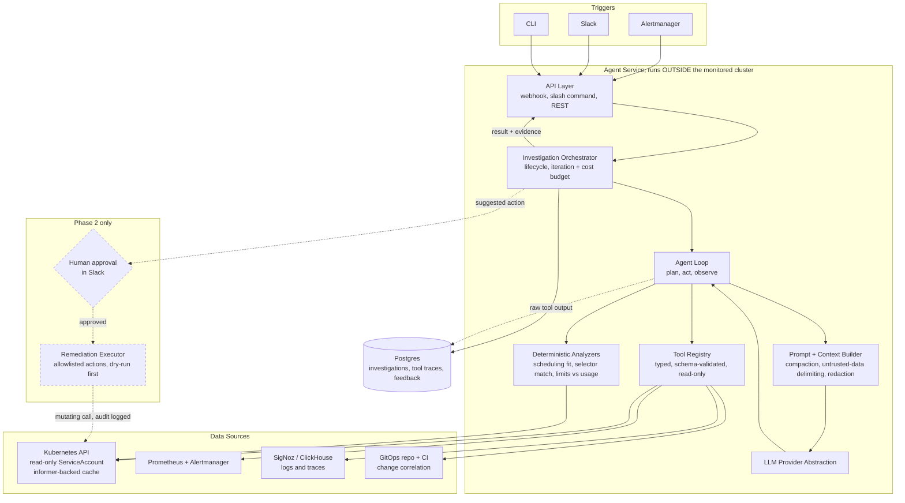
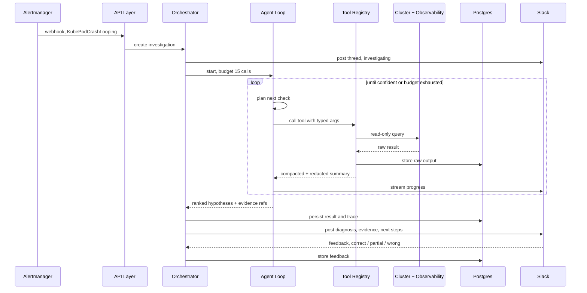

# PRD: Kubernetes Incident Troubleshooting Agent

**Working name:** `k8s-triage-agent`
**Owner:** David
**Status:** Draft v0.1
**Last updated:** 2026-07-27

---

## 1. Problem Statement

When something breaks in a Kubernetes cluster, the first 15 minutes of an incident are spent
on mechanical work rather than thinking: pulling pod status, reading events, tailing logs from
the right container, checking node pressure, comparing against the last deploy, and correlating
all of it with Prometheus alerts. This work is repetitive, well documented in runbooks, and
mostly identical across incidents.

The cost is measurable:

- Time to first hypothesis is dominated by data gathering, not analysis.
- On-call engineers with less cluster context escalate early, pulling in senior engineers for
  problems that a runbook already covers.
- Post-incident, the reasoning chain is rarely captured, so the same investigation is repeated
  the next time the symptom appears.

**Goal:** an agent that receives an alert or a natural-language question, autonomously gathers
the relevant cluster evidence, and returns a ranked set of hypotheses with the supporting
evidence and a suggested remediation. Read-only by default, with human-approved remediation
as a later phase.

---

## 2. Goals and Non-Goals

### Goals

| # | Goal |
|---|------|
| G1 | Cut time-to-first-hypothesis for common workload failures to under 60 seconds |
| G2 | Produce a diagnosis that cites the exact evidence used, so a human can verify it fast |
| G3 | Operate safely by default: read-only RBAC, no mutations without explicit approval |
| G4 | Integrate into the existing alerting path (Alertmanager) and chat surface (Slack) |
| G5 | Be measurably correct against a fixed benchmark of reproducible failure scenarios |

### Non-Goals

- Replacing the on-call engineer or making the final call on customer-impacting decisions.
- Being a general-purpose Kubernetes chatbot for documentation questions.
- Autonomous remediation in production without a human in the loop (explicitly out of scope
  for v1 and v2).
- Root-causing application business logic bugs. Scope is infrastructure and platform layer.
- Replacing Prometheus, Grafana, or the existing observability stack. The agent is a consumer
  of those systems, not a replacement.

---

## 3. Users and Use Cases

### Personas

**P1: Primary on-call SRE.** Deep cluster knowledge. Wants the agent to skip the data
gathering and hand over a structured evidence packet. Low tolerance for confident wrong
answers.

**P2: Secondary on-call / product engineer.** Owns a service but not the platform. Wants a
plain-language explanation of why their pods are unhealthy and whether it is their problem or
the platform's.

**P3: Platform engineer (offline use).** Uses the agent outside incidents to investigate
cluster hygiene, noisy neighbors, and recurring CrashLoopBackOff patterns.

### Primary Use Cases

| ID | Use case | Trigger |
|----|----------|---------|
| UC1 | Alert-driven triage: Alertmanager fires, agent auto-investigates and posts findings to the incident channel | Webhook |
| UC2 | Ask-driven triage: "why is checkout-api degraded in prod?" | Slack / CLI |
| UC3 | Deploy correlation: "did the last rollout cause this?" | Slack / CLI |
| UC4 | Node-level triage: node NotReady, disk pressure, memory pressure | Webhook / ask |
| UC5 | Suggested remediation: agent proposes a concrete action with a dry-run diff | Follow-up to UC1-UC4 |

### Target Failure Classes (v1)

The agent must handle these categories, which cover the large majority of real cluster
incidents:

1. **Pod scheduling failures.** Insufficient CPU/memory, taints and tolerations, node
   affinity, topology spread constraints, PVC not bound, unschedulable nodes.
2. **Container startup failures.** ImagePullBackOff, CreateContainerConfigError, missing
   ConfigMap or Secret, bad command or entrypoint, init container failures.
3. **CrashLoopBackOff.** Application exit codes, OOMKilled, failing liveness probes,
   misconfigured readiness probes causing endpoint churn.
4. **Resource pressure.** Node memory/disk/PID pressure, evictions, throttled CPU, noisy
   neighbor identification, requests versus limits mismatch.
5. **Networking and service reachability.** Endpoints not populated, selector mismatch,
   NetworkPolicy blocking traffic, Ingress or Gateway misconfiguration, DNS resolution
   failures, service mesh sidecar issues.
6. **Storage.** PVC pending, StorageClass issues, volume attach/detach failures, multi-attach
   errors.
7. **Rollout and controller issues.** Deployment stuck, ReplicaSet not scaling, HPA not
   reacting, PodDisruptionBudget blocking eviction, StatefulSet ordering deadlock.

---

## 4. Scope and Phasing

### Phase 0: Read-Only Diagnosis (MVP)

Agent gathers evidence and produces a diagnosis. No writes to the cluster. Slack and CLI
surfaces only. Single cluster.

### Phase 1: Alert Integration and Multi-Cluster

Alertmanager webhook receiver. Cluster registry with per-cluster credentials. Persistent
investigation history and a searchable archive of past diagnoses.

### Phase 2: Guarded Remediation

Agent proposes actions from a fixed allowlist. Every action requires explicit human approval
in Slack, executes with a dry-run diff first, is fully audit-logged, and supports rollback.
Allowlist starts narrow: restart a deployment, scale a deployment, delete a stuck pod,
cordon a node.

### Phase 3: Learning Loop

Feedback capture on every diagnosis (correct / partially correct / wrong). Retrieval over past
incidents and runbooks. Postmortem draft generation.

---

## 5. Functional Requirements

### 5.1 Agent Core

| ID | Requirement | Priority |
|----|-------------|----------|
| FR-1 | Accept an investigation request from webhook, Slack, CLI, or REST API | P0 |
| FR-2 | Run an agentic loop: plan, call a tool, observe, refine, until confident or budget exhausted | P0 |
| FR-3 | Enforce a hard iteration budget (default 15 tool calls) and a token/cost budget per investigation | P0 |
| FR-4 | Emit a structured result: ranked hypotheses, confidence, evidence citations, suggested next steps | P0 |
| FR-5 | Stream partial progress so the user sees what the agent is checking in real time | P1 |
| FR-6 | Support cancellation of an in-flight investigation | P1 |
| FR-7 | Persist the full trace of every investigation, including every tool call and its raw output | P0 |

### 5.2 Tool Catalog

Tools are the agent's only access to the world. Every tool is read-only in Phase 0 and 1.

**Cluster state tools**

| Tool | Description |
|------|-------------|
| `list_resources` | List resources by kind, namespace, label selector |
| `get_resource` | Full manifest of a named resource |
| `describe_resource` | Human-readable describe output including events |
| `get_events` | Cluster events filtered by involved object, namespace, time window |
| `get_pod_logs` | Container logs with tail, since, previous-container support |
| `get_node_status` | Node conditions, allocatable versus allocated, taints |
| `get_resource_usage` | Live CPU/memory from metrics-server for pods and nodes |
| `explain_scheduling` | Why a pending pod cannot schedule, derived from scheduler events and node fit analysis |

**Observability tools**

| Tool | Description |
|------|-------------|
| `query_prometheus` | Instant and range PromQL queries |
| `list_firing_alerts` | Currently firing Alertmanager alerts, with grouping |
| `query_logs` | Structured log search against the log backend |
| `query_traces` | Trace lookup and latency breakdown by service |
| `get_slo_status` | Error budget burn rate for the affected service |

**Change correlation tools**

| Tool | Description |
|------|-------------|
| `get_rollout_history` | Deployment revision history with timestamps and image tags |
| `get_recent_changes` | Recent GitOps commits or CI pipeline runs touching the affected namespace |
| `diff_revisions` | Diff between two Deployment revisions |

### 5.3 Output Contract

Every investigation returns this structure:

```json
{
  "investigation_id": "inv_01H...",
  "cluster": "prod-gke-asia-southeast2",
  "trigger": { "type": "alert", "name": "KubePodCrashLooping" },
  "summary": "One-paragraph plain-language explanation",
  "hypotheses": [
    {
      "rank": 1,
      "confidence": "high",
      "statement": "Pod is OOMKilled because the memory limit is below steady-state usage",
      "evidence": [
        { "tool": "describe_resource", "detail": "lastState.terminated.reason=OOMKilled, exitCode 137" },
        { "tool": "query_prometheus", "detail": "container_memory_working_set_bytes p95 = 480Mi vs limit 512Mi" }
      ],
      "suggested_action": {
        "description": "Raise memory limit to 768Mi",
        "risk": "low",
        "requires_approval": true
      }
    }
  ],
  "ruled_out": [
    { "statement": "Node memory pressure", "reason": "All nodes report MemoryPressure=False" }
  ],
  "unknowns": ["No trace data available for this service"],
  "tool_calls": 9,
  "duration_ms": 34210,
  "cost_usd": 0.08
}
```

Hard rules on output:

- Every hypothesis must cite at least one piece of evidence from an actual tool call.
- The agent must state what it could not determine rather than filling gaps with plausible
  guesses.
- If confidence is low across all hypotheses, say so explicitly and list what a human should
  check next.

### 5.4 Interfaces

**Slack (primary).** Slash command for ad-hoc questions, threaded auto-investigation when an
alert fires, interactive buttons for approval in Phase 2, thumbs up/down for feedback.

**CLI.** Single binary, reads local kubeconfig context, useful for local debugging and for
platform engineers who live in the terminal.

**REST API.** Enables the webhook receiver and any future UI. OpenAPI spec published.

**Web UI.** Deferred. Investigation history and trace inspection would be the first screens.

---

## 6. Architecture

### 6.1 High-Level



**Investigation flow, UC1 alert-driven:**



### 6.2 Component Breakdown (Go)

Layered structure consistent with your existing services:

```
cmd/
  agent-server/          # API server + webhook receiver
  agent-cli/             # local CLI
internal/
  handler/               # HTTP handlers, Slack handlers, webhook receiver
  usecase/
    investigation/       # orchestration, budget enforcement, result assembly
    remediation/         # Phase 2: approval flow, dry-run, execution
  agent/
    loop/                # plan-act-observe loop
    llm/                 # provider abstraction (Anthropic, others)
    prompt/              # system prompt, context assembly, redaction
    tools/               # tool registry, schemas, dispatch
  repository/
    kubernetes/          # typed client wrappers, informer cache
    prometheus/
    logs/
    postgres/            # investigation persistence
  domain/                # entities: Investigation, Hypothesis, Evidence, Tool
  config/                # Viper-backed configuration
pkg/
  redact/                # secret and PII scrubbing
```

### 6.3 Key Design Decisions

**Tools over free-form kubectl.** The agent never executes arbitrary shell or kubectl
commands. It calls typed, schema-validated tools. This makes the blast radius auditable and
the behavior testable.

**Informer-backed cache.** For hot resources (pods, events, nodes) use shared informers rather
than hitting the API server on every tool call. Cuts latency and protects the API server
during an incident, which is exactly when it is already under stress.

**LLM provider abstraction.** A single interface with an Anthropic implementation first.
Prompt templates and tool schemas live outside the provider so swapping models does not
require rewriting the agent.

**Context compaction.** Raw kubectl output blows through a context window fast. Every tool
returns a compacted, structured summary with a pointer to the full output stored in Postgres.
Log tools sample and cluster similar lines rather than dumping 10,000 lines.

**Determinism where possible.** Scheduling analysis, selector-mismatch detection, and
resource-limit comparison are deterministic checks written in Go, not LLM reasoning. The LLM
orchestrates and explains; it does not do arithmetic that code can do correctly.

---

## 7. Safety and Security

This is the section that decides whether the agent is deployable in production.

| ID | Requirement |
|----|-------------|
| SEC-1 | Phase 0/1 ServiceAccount is bound to a ClusterRole with `get`, `list`, `watch` only. No `create`, `update`, `patch`, `delete` verbs exist in the binding |
| SEC-2 | Secret values are never read. `get_resource` on a Secret returns key names and metadata only, never the data payload |
| SEC-3 | All tool output passes through a redaction layer before entering the LLM context: tokens, passwords, connection strings, private keys, common credential patterns |
| SEC-4 | Namespace allowlist/denylist per cluster. `kube-system` access is opt-in |
| SEC-5 | Every LLM call and tool call is logged with inputs, outputs, timestamp, and requesting identity. Retention configurable |
| SEC-6 | Phase 2 mutations require: explicit human approval, an allowlisted action type, a server-side dry-run, and a recorded approver identity |
| SEC-7 | Phase 2 actions are rate-limited and blocked entirely during a declared change freeze |
| SEC-8 | The agent is deployed with its own workload identity, not a shared platform identity |
| SEC-9 | Prompt injection defense: content from cluster resources (annotations, logs, image names) is clearly delimited as untrusted data in the prompt and the system prompt instructs the model to never treat it as instructions |
| SEC-10 | Per-investigation cost ceiling. Hard stop, not a warning |

SEC-9 deserves emphasis. Anyone who can set a pod annotation or write a log line can attempt to
inject instructions into the agent's context. In Phase 2 this becomes a privilege escalation
path. Treat all cluster-sourced text as hostile input.

---

## 8. Non-Functional Requirements

| Category | Requirement |
|----------|-------------|
| Latency | p50 under 30s, p95 under 90s for a Phase 0 investigation |
| Availability | The agent must not be a dependency of the cluster it monitors. Deploy it in a separate cluster or accept that it is unavailable during a control plane outage |
| Cost | Under $0.25 per investigation at p95. Track and expose cost per investigation |
| Scalability | 20 concurrent investigations without queueing |
| Observability | The agent instruments itself with OpenTelemetry: traces per investigation, spans per tool call, metrics on tool latency, token usage, and hypothesis accuracy |
| Reliability | Degrade gracefully. If Prometheus is unreachable, continue with cluster state only and mark the gap in `unknowns` |

The availability requirement matters more than it looks. An agent that runs in the cluster it
diagnoses is useless during exactly the outages you most want help with. Run it out-of-cluster
or in a dedicated management cluster.

---

## 9. Success Metrics

| Metric | Target | How measured |
|--------|--------|--------------|
| Diagnosis accuracy on benchmark | ≥ 80% top-1 correct | Fixed scenario suite, see section 10 |
| Time to first hypothesis | ≤ 60s p95 | Instrumented |
| On-call feedback: "this was useful" | ≥ 70% | Slack thumbs up/down |
| False confidence rate | ≤ 5% | High-confidence diagnoses later marked wrong |
| Adoption | ≥ 60% of P1/P2 alerts get an agent investigation attached | Alert correlation |
| Cost per investigation | ≤ $0.25 p95 | Instrumented |

False confidence rate is the metric that matters most. An agent that says "I do not know" is
useful. An agent that confidently sends an engineer down the wrong path during an outage is
worse than no agent.

---

## 10. Evaluation Plan

Do not ship this on vibes. Build the benchmark before building the agent.

**Scenario suite.** A set of reproducible broken states applied to a kind or ephemeral GKE
cluster via Terraform and manifests. Each scenario has a known root cause. Target 40 scenarios
across the seven failure classes in section 3, including:

- Deployment with a memory limit below working set, causing OOMKill
- Pod with a nodeSelector matching no node
- Service with a selector that matches no pods
- ImagePullBackOff from a private registry with a missing imagePullSecret
- PVC pending because of an unavailable StorageClass zone
- NetworkPolicy denying ingress to a backend
- PDB blocking a node drain
- Init container failing on a missing ConfigMap key
- Two scenarios with overlapping symptoms and different root causes, to test discrimination
- Two scenarios where the correct answer is "insufficient evidence"

**Scoring.** Automated. For each scenario, check whether the top-1 hypothesis matches the
known root cause, whether evidence citations are real (verify the cited tool calls actually
occurred and returned what was claimed), and record tool call count and cost.

**Regression gate.** The suite runs in CI on every prompt or tool change. A drop in top-1
accuracy blocks the merge. Prompt changes are code changes and get reviewed as such.

**Shadow mode.** Before Slack rollout, run the agent silently on every production alert for
two weeks. Compare its diagnosis against the eventual human root cause from incident notes.

---

## 11. Prior Art

Evaluate before building. `k8sgpt` and `HolmesGPT` both occupy this space, and there are
several commercial AIOps products with similar claims. Spend a day running them against three
or four of your benchmark scenarios first.

Reasons to build anyway, if they hold after evaluation:

- Deep integration with your specific stack (SigNoz/ClickHouse, your GitOps repo layout, your
  alert taxonomy) is where most of the accuracy comes from, and generic tools cannot have it.
- The safety model you need for a production cluster is stricter than a general tool ships
  with.
- It is a strong portfolio artifact demonstrating agentic system design, not just prompt
  wrapping.

If they do not hold, the honest outcome is to contribute the missing tools upstream instead.

---

## 12. Milestones

| Milestone | Deliverable | Estimate |
|-----------|-------------|----------|
| M0 | Benchmark suite: 15 reproducible scenarios on kind, automated scoring harness | 1 week |
| M1 | Tool layer: read-only K8s client, 8 core tools, unit tested against envtest | 1.5 weeks |
| M2 | Agent loop: planning, tool dispatch, budget enforcement, structured output | 1.5 weeks |
| M3 | CLI surface, run full benchmark, iterate prompts to hit 70% top-1 | 1 week |
| M4 | Prometheus and log tools, expand benchmark to 40 scenarios, target 80% | 1 week |
| M5 | Slack bot, Alertmanager webhook, Postgres persistence | 1.5 weeks |
| M6 | Shadow mode in production, feedback capture | 2 weeks running |
| M7 | Phase 2: remediation with approval flow, narrow allowlist | 2 weeks |

---

## 13. Risks

| Risk | Impact | Mitigation |
|------|--------|------------|
| Confident wrong diagnosis misleads on-call during an outage | High | Mandatory evidence citation, explicit `unknowns`, false-confidence metric tracked and gated |
| Prompt injection via cluster annotations or logs | High in Phase 2 | SEC-9, untrusted-data delimiting, no mutations without human approval |
| Context window exhaustion on large clusters | Medium | Tool-side compaction, log sampling, iteration budget |
| Agent load worsens an ongoing API server incident | Medium | Informer cache, client-side rate limiting, circuit breaker on API server latency |
| Cost growth as usage scales | Medium | Per-investigation ceiling, cheaper model for tool selection, expensive model only for final synthesis |
| Benchmark overfitting | Medium | Hold out 10 scenarios never used during prompt iteration |
| Model provider change breaks behavior | Low | Provider abstraction, benchmark as regression gate |

---

## 14. Open Questions

1. Which log backend does the agent query in v1: SigNoz/ClickHouse, or the GKE-native logging
   path? This affects the `query_logs` tool contract.
2. Single-cluster or multi-cluster from M1? Multi-cluster credential management is meaningful
   extra work and can be deferred to Phase 1.
3. Does the agent get read access to the GitOps repository for change correlation, and if so,
   read-only deploy key or app token?
4. Where does it run? Separate management cluster, a VM, or a serverless surface. Section 8
   argues against in-cluster.
5. Which model tier for the loop versus the final synthesis? A cheaper model for tool selection
   and an expensive one for synthesis is likely the right cost/quality split, but should be
   validated on the benchmark.
6. Retention period for investigation traces, given they contain cluster state.
